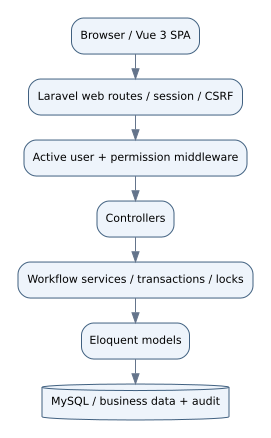
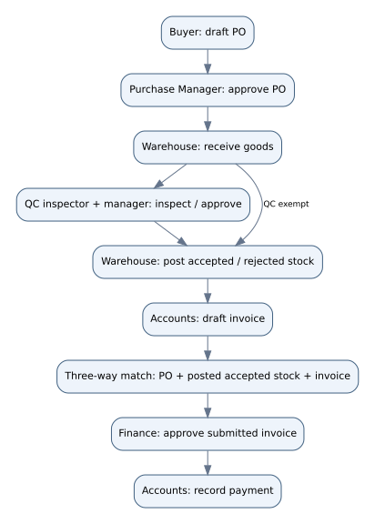
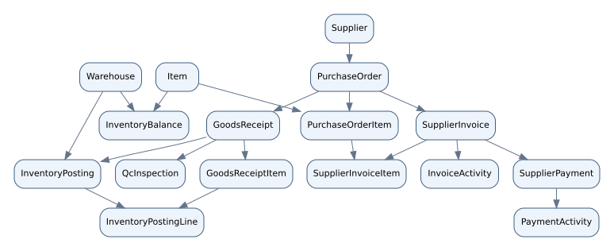

# ERP P2P | Functional and technical documentation

## 1. Objective and scope
Demonstrate a controlled procurement-to-payment cycle for a business purchasing materials. The application connects operational and financial records rather than treating each screen as an isolated CRUD module. Scope begins at purchase orders; requisition permissions exist but a complete requisition module is not claimed.

## 2. Architecture

Vue 3 presents the SPA; Laravel web routes handle session-authenticated JSON requests. Middleware checks active accounts and permissions. Controllers validate inputs and delegate workflow operations to services. Eloquent persists records in MySQL. Financial and inventory services use transactions and row locks to protect state changes. Vite builds frontend assets.

## 3. Business process

Buyer creates and submits PO; Purchase Manager approves or rejects. Warehouse records partial receipts against approved orders. QC Inspector records accepted and rejected quantities; QC Manager decides. Warehouse posts inventory after required QC approval. QC-exempt receipts can be posted without inspection. Accounts creates and matches invoices, submits matched invoices, Finance approves or rejects, and Accounts records payments.

## 4. Business rules
| Area | Control |
|---|---|
| PO | Creator ownership, state restrictions, no self-approval |
| GRN | Approved PO, outstanding quantity, unique delivery reference |
| QC | Accepted + rejected equals received; independent approval |
| Inventory | No repeated posting; warehouse balances and movement records |
| Invoice | PO must be approved; compare price and accepted posted quantity less reservations |
| Payment | Approved invoice, positive INR amount, no overpayment, unique supplier/reference |
| Audit | Actor, action, status transitions and snapshots where implemented |

## 5. Data architecture

This diagram is a conceptual subset, not a complete migration-level ERD. Core records include PO headers/lines, GRN headers/lines, QC inspections, inventory postings/lines, balances and movements, invoice headers/lines/activities and payments/activities. Suppliers, items, warehouses and users are shared master records. Foreign keys and unique indexes complement service validation.

## 6. Demonstrated financial scenario
Approved PO: 1,000 steel plates at INR 250 = INR 250,000. Accepted posted quantity: 600. Approved invoice SI-2026-000001: INR 150,000. Payments PAY-2026-000001 and PAY-2026-000002: INR 100,000 and INR 50,000. Outstanding: INR 0. These are previously verified development sample records, not test fixtures.

## 7. Security and integrity
Session authentication, active-user middleware, permission middleware, service checks and segregation of duties. Invoice matching serializes operations on the parent PO and checks posted accepted quantities and prior reservations. Payment processing locks the invoice and uses integer paise for monetary checks. The supplier/payment-reference pair has a unique database index. Eight cross-record consistency queries and financial reconciliation passed for examined sample records. Audit history is not claimed to be tamper-proof.

## 8. Verification and limitations
56 automated tests passed with 359 assertions. Dedicated MySQL test database isolates development data. Financial modules were manually exercised and reviewed; dedicated automated financial suites remain optional future work. Final access seeder correction and development-route removal are outstanding or unconfirmed; verify remaining PO audit patches. Do not claim load testing, production deployment or formal security certification.

## 9. Local operation and demo
See ../README.md for setup and DEMO_ACCESS.md for private local credentials. Back up development data before configuration changes. Do not run destructive migration commands against development. Keep production debug disabled and use unique secrets if deploying.
